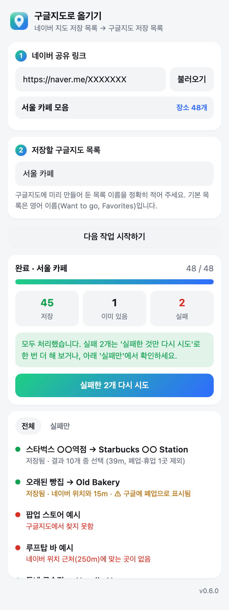

<p align="center"></p>

<h1 align="center">네이버 지도 → 구글지도 저장 목록</h1>

<p align="center">네이버 지도의 저장 목록 공유 링크 하나로, 그 장소들을 내 구글지도 저장 목록에 옮겨 주는 크롬 확장 프로그램 (시제품)</p>

<p align="center"><sub>A Chrome extension that copies places from a shared Naver Map list into your Google Maps saved list.</sub></p>

---

## 왜 만들었나

해외여행이나 구글지도를 주로 쓰는 상황에서는 네이버 지도에 모아 둔 장소를 구글지도로 옮기고 싶어진다. 하지만

- 구글지도 **저장 목록**에는 파일 가져오기 기능도, 공개 API도 없다.
- 공식적으로 가능한 길은 **구글 마이맵(KML 가져오기)** 뿐인데, 이건 저장 목록이 아니라 별도의 지도다.

그래서 사람이 하던 일(검색 → 장소 확인 → 저장 → 목록 선택)을 브라우저 안에서 대신 수행하는 확장 프로그램을 만들었다.

<p align="center"></p>

## 실사용 결과

내 네이버 저장 목록으로 직접 돌려 본 결과다. 첫 시도에서 나온 실패를 보고 판별 로직을 고친 뒤 다시 돌렸다.

| 회차 | 장소 | 자동 저장 | 실패 | 성공률 |
|---|---:|---:|---:|---:|
| 첫 시도 | 163곳 | 143곳 | 20곳 | 87.7% |
| 수정 후 최근 시도 | 174곳 | 169곳 | 5곳 | 97.1% |

남은 실패는 구글지도에서 찾을 수 없는 곳, 목록 메뉴가 열리지 않은 경우 등이다. 목록 메뉴 쪽은 페이지 로딩이 늦어서 생긴 것으로 보고 있어, v0.6.0에 **실패한 것만 다시 시도** 버튼을 넣었다. 이 버튼으로 몇 곳이 더 살아나는지는 아직 재지 않았다.

## 기능

- **링크만 넣으면 끝**: `naver.me/…` 공유 링크에서 장소 이름·주소·좌표를 직접 읽어 온다.
- **같은 이름 매장 자동 판별**: 검색 결과가 여러 개면 네이버 좌표와의 거리, 영업 상태(폐업·임시 휴업), 이름 유사도를 함께 보고 하나를 고른다. 사람이 일일이 확인할 필요가 없다.
- **중단 알림**: 툴바 아이콘이 원형 상태 표시로 바뀐다. 진행 중이면 남은 개수와 진행 고리, 멈추면 빨간 `!`, 끝나면 초록 체크.
- **이어서 / 실패한 것만 다시 시도**: 로그인 풀림, 구글 로봇 확인, 브라우저 재시작 등으로 멈춰도 멈춘 장소부터 계속하고, 실패한 장소만 골라 다시 돌릴 수 있다.
- **외부 서버 없음**: 모든 처리가 내 브라우저 안에서 일어난다. 구글 비밀번호를 다루지 않고, 이미 로그인된 브라우저에서 클릭만 대신한다.

<p align="center"></p>

## 설치 (개발자 모드)

1. 이 저장소를 내려받는다 (`Code → Download ZIP` 후 압축 해제, 또는 `git clone`).
2. Chrome 주소창에 `chrome://extensions` → 오른쪽 위 **개발자 모드** 켜기.
3. **압축해제된 확장 프로그램을 로드합니다** → `extension` 폴더 선택.
4. 툴바의 퍼즐 아이콘에서 확장을 고정해 두면 상태 표시를 보기 쉽다.

## 사용법

1. 네이버 지도 앱/웹에서 저장 목록 → **공유** → 링크 복사.
2. 구글지도에 옮겨 담을 **목록을 미리 만들어 둔다** (예: `서울 카페`). 기본 목록은 영어 이름(`Want to go`, `Favorites`)으로 적는다.
3. Chrome에서 구글에 로그인된 상태로 확장 아이콘 클릭 → 링크 붙여 넣고 **불러오기** → 목록 이름 입력 → **저장 시작**.
4. 작업용 탭이 하나 열리고 장소를 차례로 저장한다. 끝나면 결과 목록에서 실패한 장소를 확인한다.

## 작동 원리

```
네이버 공유 링크 ──▶ 폴더 ID ──▶ 네이버 저장 목록 API ──▶ [이름, 주소, 위도·경도] × N
                                                             │
          ┌──────────────────────────────────────────────────┘
          ▼  장소마다
  ① 구글지도 검색 (이름 + 주소)          ── 결과 없음/멀리 떨어짐 ──▶ ② 네이버 좌표 주변에서 이름으로 재검색
          │
          ▼  결과가 여러 개면
  후보 점수 = 좌표 거리(m) − 이름 비슷하면 100 + 임시 휴업 150 / 폐업 1000   (250m 이내 후보만)
          │
          ▼  점수가 가장 낮은 장소 페이지에서
  Save → 목록 선택 → 체크 상태 확인 ──▶ 결과 기록 (chrome.storage) ──▶ 팝업·아이콘 갱신
```

- **좌표 비교**: 구글지도 장소 URL에 들어 있는 [플러스 코드](https://maps.google.com/pluscodes/)(`!20s8Q99H276+FHJ` 형태)를 위경도로 풀고, 네이버 좌표와의 거리를 하버사인 공식으로 계산한다.
- **네이버 목록 읽기**: 네이버 서버는 확장 프로그램 출처(`chrome-extension://`)의 요청을 거부한다. `declarativeNetRequest`로 확장 자신이 보내는 요청에만 `Origin` 헤더를 `https://map.naver.com`으로 바꾼다.
- **화면 판별**: 구글지도를 영어 UI(`hl=en`)로 고정해 버튼 이름(`Save`, `Save in your lists`)이 언어에 따라 달라지지 않게 했다. 고정 대기 대신 화면 상태가 바뀌는 즉시 다음 단계로 넘어가고, 장소 사이에는 1~2.5초 무작위 간격을 둔다.
- **멈춤 감지**: 진행 상태와 마지막 활동 시각을 저장하고, 1분마다 점검해 서비스 워커가 끊긴 작업을 '멈춤'으로 바꾼다.

### 파일 구성

| 파일 | 역할 |
|---|---|
| `extension/geo.js` | 플러스 코드 해석, 거리 계산, 이름 비교, 후보 점수. chrome API를 쓰지 않는 순수 함수라 단위 테스트 대상 |
| `extension/background.js` | 서비스 워커. 네이버 목록 읽기, 장소 큐 실행, 구글지도 탭 조작, 상태 기록, 아이콘 그리기 |
| `extension/popup.html`, `popup.js` | 링크·목록 입력, 진행 상황과 결과 표시 |
| `tests/geo.test.js` | `geo.js` 단위 테스트 |
| `naver2mymaps.py` | 마이맵용 KML/CSV 변환기 (부록) |

## 테스트

정확도를 좌우하는 순수 함수(`extension/geo.js`)에 단위 테스트를 붙였다. Node 18 이상에서 별도 설치 없이 돌아간다.

```bash
node --test
```

- `decodePlus`: [Open Location Code 공식 테스트 벡터](https://github.com/google/open-location-code/blob/main/test_data/decoding.csv) 12개로 셀 중심 좌표 확인
- `distM`: 위도 1도 = 111,195m, 북쪽 250m·동쪽 77m 지점, 대칭성
- `score`, `rankCandidates`: 폐업한 가장 가까운 곳보다 영업 중인 곳을 먼저 고르는지, 250m 밖과 좌표 없는 결과를 빼는지, 이름이 같은 가게에 가산점을 주는지

구글지도 화면을 다루는 부분(`inspectPage`, `saveInPage`)은 실제 페이지가 있어야 해서 단위 테스트 범위 밖이다. 이 부분은 위의 실사용 결과로 확인했다.

## 실패 유형

| 구분 | 상태 | 의미 |
|---|---|---|
| 장소 하나만 실패 (계속 진행) | 근처(250m)에 맞는 곳 없음 | 검색 결과는 있으나 네이버 위치 근처가 아님 (미등록·폐업·이름 차이) |
| | 구글지도에서 찾지 못함 | 두 가지 검색 모두 결과 없음 |
| | 저장 버튼 / 목록 메뉴 / 스크립트 오류 | 대부분 로딩 지연. **실패한 것만 다시 시도**로 해결되는 경우가 많다 |
| | 저장 확인 안 됨 | 눌렀지만 체크 표시를 확인하지 못함 (실제로는 저장된 경우가 많음) |
| 전체 멈춤 (빨간 `!`) | 로봇 확인 / 로그인 안 됨 / 목록 이름 없음 / 탭 닫힘 / 재시작 | 원인을 해결한 뒤 **이어서** |

## 한계와 주의

- **비공식 경로에 의존**한다. 네이버 내부 API나 구글지도 화면 구조가 바뀌면 동작하지 않을 수 있다.
- 구글지도 화면을 자동으로 조작하는 방식이라, 많이 빠르게 돌리면 구글이 로봇 확인을 띄운다. 개인 용도로 적당한 양만 쓰는 것을 전제로 한다.
- 폐업·휴업 판별은 구글 결과의 영어 문구(`Permanently closed`, `Temporarily closed`)를 읽는다. 이 문구를 실제 화면에서 제대로 읽는지는 따로 확인하지 못했다.
- 시제품이다. 크롬 웹 스토어에는 올리지 않았다.

## 부록: 마이맵용 KML 변환기

확장 프로그램 없이 공식 기능만 쓰고 싶다면, 네이버 공유 목록을 **구글 마이맵**에 가져올 수 있는 KML/CSV로 바꿔 준다 (파이썬 표준 라이브러리만 사용).

```bash
python3 naver2mymaps.py https://naver.me/XXXXXXX
```

## 참고

- 브라우저 자동화로 구글지도 목록에 저장하는 아이디어는 [jayden626/google-maps-list-importer](https://github.com/jayden626/google-maps-list-importer)를 참고했다. 코드는 새로 작성했다.

## 라이선스

[MIT](LICENSE)
